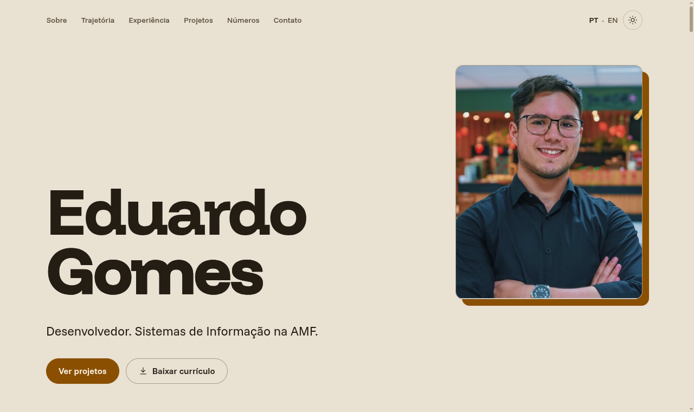

<a href="https://gomesbeduardo.github.io/">
  <picture>
    <source media="(prefers-color-scheme: dark)" srcset="docs/readme/inicio-escuro.png">
    
  </picture>
</a>

# Eduardo Gomes · portfólio

[](https://github.com/gomesbeduardo/gomesbeduardo.github.io/actions/workflows/pages.yml)

Sou desenvolvedor full stack, com foco em IA aplicada e automação. Faço estágio no time de Inovação da Asten AVMB, atendo a CentralEng sob demanda e estudo Sistemas de Informação na AMF, em Santa Maria, RS. Este repositório guarda o código do meu portfólio, que roda em **[gomesbeduardo.github.io](https://gomesbeduardo.github.io/)**, em português, e em **[/en/](https://gomesbeduardo.github.io/en/)**, em inglês.

No site você encontra:

- os projetos [leadgate](https://github.com/gomesbeduardo/leadgate) (assistente de IA que qualifica leads, com 570 testes) e [InfoHub InovAMF](https://github.com/gomesbeduardo/infohub-inovamf), além do LMS de treinamento técnico da CentralEng, em validação com os colaboradores;
- a trajetória, de um `hello, world` em C no CS50 em 2018 ao ToPark, startup da primeira turma da incubadora InovAMF, ao 1º lugar no Ideathon de SI da AMF em 2025, ao 2º lugar em 2026 e ao título do Coderace 2026;
- os números do meu GitHub dos últimos 12 meses, com o calendário de contribuições;
- o currículo em PDF, nas duas línguas.

Abra o DevTools na página inicial: tem 10 curiosidades escondidas pelas seções, e o console conta quantas você já achou.

## Como eu montei

Escrevo cada mudança numa spec curta, com critérios de aceite, antes do código. As specs ficam em [`docs/specs/`](docs/specs/). O Claude Code escreveu a maior parte do código sob esse fluxo, com teste antes da implementação, um agente por função e a minha aprovação antes de cada merge. O botão "Feito com o Claude Code", no rodapé do site, explica o método.

| Peça | O que faz | Onde |
|---|---|---|
| Site | HTML, CSS e JS sem build, com GSAP, ScrollTrigger e Lenis para o movimento | [`site/`](site/) |
| Números do GitHub | Coletor que consulta a API GraphQL do GitHub e grava um JSON com contrato validado | [`scripts/github/`](scripts/github/), spec [002](docs/specs/002-numeros-github.md) |
| Currículo | Gera os PDFs em PT e EN a partir de um JSON, com o Chrome do sistema, e confere se cabem em 1 a 2 páginas | [`scripts/curriculo/`](scripts/curriculo/), spec [003](docs/specs/003-curriculo.md) |
| Tema | Claro e escuro conforme o sistema, com botão para trocar e a escolha salva | [`site/tema.js`](site/tema.js) |
| Deploy | O GitHub Actions publica `site/` no Pages a cada merge na `main` | [`.github/workflows/pages.yml`](.github/workflows/pages.yml) |
| CI | Testes dos scripts e geração dos PDFs em cada PR | [`.github/workflows/ci.yml`](.github/workflows/ci.yml) |

Quem ativa a redução de movimento no sistema recebe a página parada, com todo o conteúdo visível. A faixa de tecnologias vira uma lista, e o foco do teclado aparece em todos os controles.

## Rodar na sua máquina

Você precisa do Node 24 para os testes e de qualquer servidor estático para o site.

```sh
node --test 'scripts/**/*.test.mjs'          # 35 testes dos scripts
python3 -m http.server -d site 8000          # abre em http://localhost:8000/
node scripts/curriculo/gerar.mjs             # gera os PDFs em public/curriculo/
```

## Próximo passo

Vou migrar o site para Astro com Tailwind, com foco em SEO e em tempo de resposta. O workflow [`publicar.yml`](.github/workflows/publicar.yml) já está pronto para esse deploy e para a coleta semanal dos números do GitHub, e fica desligado até a migração.

## Contato

- E-mail: eduardobgomes100@gmail.com
- LinkedIn: [eduardo-gomes-pb](https://www.linkedin.com/in/eduardo-gomes-pb/)
- Currículo: [PT](https://gomesbeduardo.github.io/curriculo/curriculo-eduardo-gomes-pt.pdf) · [EN](https://gomesbeduardo.github.io/curriculo/curriculo-eduardo-gomes-en.pdf)

---

**In English.** This repo holds my portfolio, live at [gomesbeduardo.github.io/en/](https://gomesbeduardo.github.io/en/). The site is static HTML, CSS and JS, and GitHub Actions deploys it to Pages. Two Node scripts collect my GitHub stats and build my résumé PDFs. I start every change from a short spec in [`docs/specs/`](docs/specs/) (in Portuguese). Run `node --test 'scripts/**/*.test.mjs'` for the tests and `python3 -m http.server -d site 8000` to browse the site locally.
