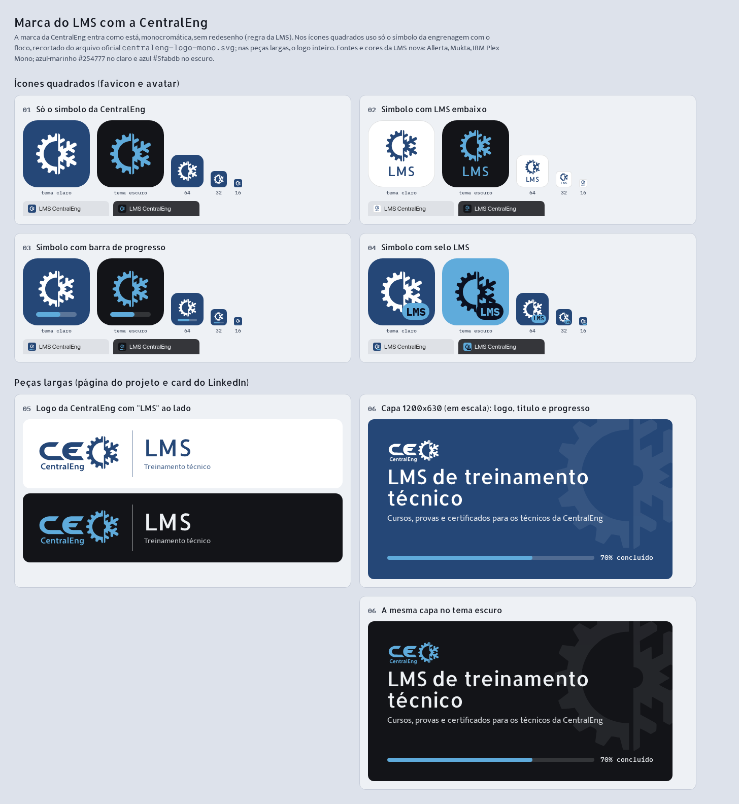

# Marca do LMS da CentralEng

Estado: escolhida pelo responsável em 12/11/2026. Ícone: opção 02. Peças largas: opções 05 e 06, usadas juntas onde couber. Uso da logo da CentralEng autorizado pelo responsável.

Serve para mostrar o LMS no portfólio: a página do projeto, o card do LinkedIn e a imagem de compartilhamento (OG). Não altera a marca dentro do próprio LMS.

## Regras de uso

- A logo da CentralEng entra como está no arquivo oficial (`public/brand/centraleng-logo-mono.svg` do repositório `LMS_CentralEng`), em uma cor só. A engrenagem com o floco nunca é redesenhada; o símbolo sozinho é o mesmo arquivo com o `viewBox` recortado em `384 40 270 270`.
- Fontes e cores são as do LMS novo (`lms-centraleng-v2`): Allerta nos títulos, Mukta no texto, IBM Plex Mono em números e progresso.

| Tema | Fundo | Marca e texto | Destaque |
|---|---|---|---|
| Claro | `#ffffff` ou azul-marinho `#254777` | `#254777` (sobre branco) ou `#ffffff` (sobre marinho) | `#5fabdb` |
| Escuro | `#131418` | logo `#5fabdb`, texto `#eef1f4` | `#5fabdb` |

## Peças

| Peça | Arquivo | Tamanho | Onde usar |
|---|---|---|---|
| Ícone 02: símbolo com "LMS" embaixo | `marca-lms/lms-icone-claro.png`, `lms-icone-escuro.png` | 512×512 | avatar, favicon de 32 px para cima |
| Ícone em 16 px: só o símbolo | `marca-lms/lms-icone-16-claro.png`, `lms-icone-16-escuro.png` | 16×16 | aba do navegador; em 16 px o texto "LMS" fica ilegível |
| Lockup 05: logo CentralEng, divisória, "LMS / Treinamento técnico" | `marca-lms/lms-lockup-claro.png`, `lms-lockup-escuro.png` | 796×272 | topo da página do projeto, assinatura em slides e docs |
| Capa 06: logo, título, frase e barra de progresso | `marca-lms/lms-capa-claro.png`, `lms-capa-escuro.png` | 1200×630 | imagem OG da página do projeto, miniatura do card do LinkedIn |

O ícone tem cantos com raio de 22% do lado, o símbolo ocupa 48% da largura e "LMS" em Allerta tem 20% do lado. A capa tem 22 px (em 600×315) entre a logo e o título.

## Como gerar de novo

As peças saem de uma página HTML renderizada no Chromium do Playwright, com as fontes do LMS baixadas localmente e os SVG da CentralEng embutidos como data URI (o Chromium bloqueia `mask-image` lido de arquivo local). Cada peça é capturada pelo seu `id`, com escala 2 para a capa (1200×630) e o ícone (512), e escala 1 para o ícone de 16 px.

## Decisões de 12/11

- Em 16 px o ícone usa só o símbolo, sem "LMS" (confirmado pelo responsável).
- A capa e o lockup entram na página do projeto LMS no site pela etapa 2 do Astro, junto com o favicon, com spec de tela aprovada antes do código.
- A capa clara é a miniatura do card do LMS no "Em destaque" do LinkedIn.
