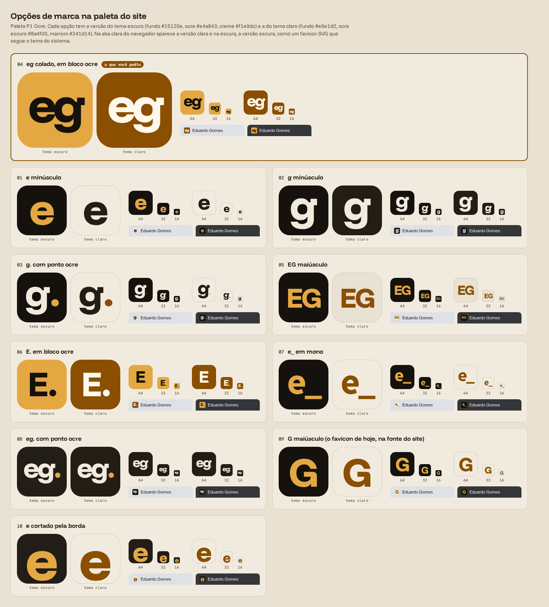

# Marca pessoal

Estado: escolhida pelo responsável em 12/11/2026 (opção 08 da rodada de 12/11). Entra no site como favicon na etapa 2 do Astro (spec 001b R8).

## A marca

"eg" em minúsculas, seguido de um ponto ocre, dentro de um quadrado de cantos arredondados.

| Peça | Valor |
|---|---|
| Letras | `eg`, Funnel Display, peso 800, minúsculas |
| Espaço entre letras | `-0.04em` |
| Ponto | círculo de `0.19em` de diâmetro, `0.05em` depois do g, apoiado na linha de base |
| Tamanho do texto | 56% do lado do quadrado, subido 8% do lado para compensar a descendente do g |
| Quadrado | cantos com raio de 22% do lado |
| Tema escuro | fundo `#221d17`, letras `#f1e9dc`, ponto `#e4a843` |
| Tema claro | fundo `#241d14`, letras `#f1ebdf`, ponto `#e4a843` |

As cores são da paleta P1 Ocre (`src/styles/legado/style.css`): `#221d17` é o `--raised` do tema escuro, `#241d14` é o `--fg` do claro, `#f1e9dc` e `#f1ebdf` são o `--fg` escuro e o `--raised` claro, e `#e4a843` é o `--accent` escuro. As duas versões são escuras de propósito: o quadrado escuro aparece nas abas claras e escuras do navegador, e o ponto ocre é o mesmo nas duas.

## Como se chegou nela

1. Monograma EG com elemento de código, gerado no Canva IA e no Dream Lab: quatro opções, recusadas.
2. Pesquisa de boas práticas de marca pessoal e favicon (resumo abaixo).
3. Pixel art e letra com corte, no Dream Lab: oito opções, nenhuma escolhida. A cota de IA do plano gratuito do Canva acabou nessa rodada (renova em 30/11).
4. Dez opções na fonte do site, desenhadas em HTML, primeiro em cores livres e depois na paleta do site. O responsável escolheu a 08.

## Regras de uso

- Favicon: sempre o quadrado com a marca, nunca as letras soltas.
- Em 16 px as duas letras ficam pequenas e o ponto tem cerca de 2 px. O favicon de 16 px é conferido em captura antes do merge (001b C10). Se não ficar legível, o responsável decide entre aceitar ou usar só o "e." no tamanho de 16 px.
- O SVG da marca não usa a fonte: as letras viram contorno (`path`), para não depender de a Funnel Display estar carregada.

## Fontes da pesquisa (12/11)

- Conjunto de arquivos de favicon: [Evil Martians, How to favicon](https://evilmartians.com/chronicles/how-to-favicon-in-2021-six-files-that-fit-most-needs).
- Manifest e ícones de 192 e 512 px: [web.dev, Add a web app manifest](https://web.dev/articles/add-manifest).
- Favicon nos resultados do Google: [Google Search Central](https://developers.google.com/search/docs/appearance/favicon-in-search).
- Tipos de logo pessoal: [Dribbble, personal logos](https://content-hub.dribbble.com/freelance/personal-logos-for-designers).
